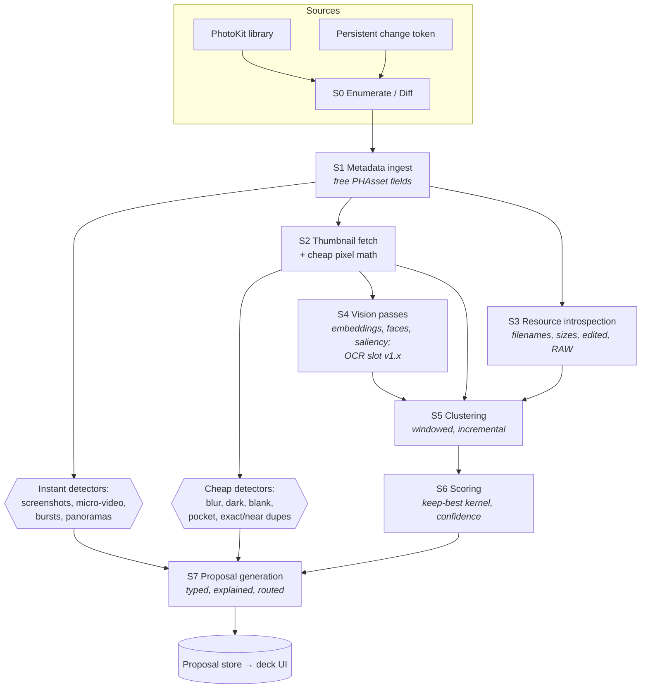

# iClean — Scan Pipeline Technical Design

**Status:** Draft v1
**Date:** 2026-08-12
**Companion to:** [DESIGN.md](DESIGN.md) — this document implements §3 (technical foundation), §4 (detection signals per action), and the scan-related open questions in §14.

---

## Table of Contents

1. [Goals & Non-Goals](#1-goals--non-goals)
2. [Constraints Recap](#2-constraints-recap)
3. [Architecture Overview](#3-architecture-overview)
4. [Persistence Layer & Data Model](#4-persistence-layer--data-model)
5. [Stage-by-Stage Specification](#5-stage-by-stage-specification)
6. [Clustering & Matching Algorithms](#6-clustering--matching-algorithms)
7. [Scoring & Confidence](#7-scoring--confidence)
8. [Scheduling, Resource Governance & Background Execution](#8-scheduling-resource-governance--background-execution)
9. [Incrementality & Change Tracking](#9-incrementality--change-tracking)
10. [Performance Budgets & Memory Strategy](#10-performance-budgets--memory-strategy)
11. [Failure Handling & Detector Versioning](#11-failure-handling--detector-versioning)
12. [Concurrency Design](#12-concurrency-design)
13. [Testing Strategy](#13-testing-strategy)
14. [Open Technical Questions](#14-open-technical-questions)
15. [Build Order](#15-build-order)

---

## 1. Goals & Non-Goals

**Goals**

- Produce the typed proposals that feed the deck UI (DESIGN.md §4, §6): duplicate clusters, similar clusters with keepers, blur/junk verdicts, screenshot buckets — each with a one-line reason and a confidence score.
- **Hub alive in ~10 seconds** after permission grant (buckets appear with live counts as tiers complete; target — validate at scale, DESIGN.md §14.3), and **first swipeable deck in ≤ 60 seconds**: the trust ladder's exact-duplicate opener (DESIGN.md §9.5 "first 60 seconds"), delivered by the dupe fast path (§5). The UI never blocks on a full scan.
- Fully **resumable**: the app can be killed at any moment and loses at most one in-flight batch.
- **Incremental forever**: after the first full scan, work is proportional to library *changes*, not library size.
- Scale to **200k-asset libraries** within memory, thermal, and battery budgets.
- 100% on-device; the pipeline has no network dependency (image loads explicitly opt out of iCloud fetches).

**Non-Goals**

- No server-side anything; no ML model downloads (Vision's built-in models only, plus small bundled custom models later).
- Not a general-purpose photo database: we persist only what detectors and proposals need.
- OCR/text-derived detectors (ephemera, chat screenshots) are v1.x; the pipeline reserves a stage slot for them but MVP does not implement it.

## 2. Constraints Recap

From DESIGN.md §3, binding on every design decision below:

1. **Thumbnail-only.** Photo analysis runs on ~500 px thumbnails requested with `isNetworkAccessAllowed = false`. Originals are touched only when verifiably local. Videos: one poster frame without the file; multi-frame analysis only for locally-available videos.
2. **No public file-size API.** Sizes come from the `PHAssetResource` `"fileSize"` KVC key with a dimensions×format fallback estimate.
3. **Camera/exposure EXIF requires original bytes** — not available for evicted assets. Free substitutes: smart-album membership, `originalFilename` patterns, UTI.
4. **"Eyes open" is derived**, not an Apple output (eye-landmark geometry).
5. Change tracking: `PHPhotoLibraryChangeObserver` (foreground) + `PHPhotoLibrary.fetchPersistentChanges(since:)` (across launches, iOS 16+).

## 3. Architecture Overview



Principles:

- **Stages are per-asset state machines, not global phases.** Each asset carries independent per-stage state (`pending / done(version) / failed(n) / needsConnection`), so a slow S4 pass on old assets never blocks instant detectors on new ones.
- **Detectors subscribe to signals, not stages.** A detector declares the signals it needs (e.g. blur needs `laplacianVariance` + `faceCount`); the orchestrator runs it when its inputs exist. Adding detector #26 means adding a signal dependency list, not rewiring the pipeline.
- **Everything flows into one proposal store** that the deck UI observes. The UI is a pure consumer; it never triggers analysis except thumbnail prefetch for cards.

## 4. Persistence Layer & Data Model

**Choice: SQLite via GRDB** (WAL mode). Rationale: bulk-insert throughput for 200k-row scans, precise index control for hash lookups, value-type records that fit Swift Concurrency, trivial migrations. Core Data/SwiftData rejected: object-graph overhead and implicit faulting fight a batch pipeline; we need plain columnar rows and covering indexes. The DB lives in the app container with `.completeUntilFirstUserAuthentication` file protection.

Schema (columns abridged to the load-bearing ones):

```sql
asset (
  id TEXT PRIMARY KEY,            -- PHAsset.localIdentifier
  mediaType INT, subtypes INT,    -- raw bitmask
  createdAt REAL, modifiedAt REAL,
  width INT, height INT, duration REAL,
  isFavorite BOOL, burstId TEXT, hasLocation BOOL,
  latBucket INT, lonBucket INT,   -- ~1km grid, for sessionization only
  filename TEXT, uti TEXT,        -- from PHAssetResource (S3)
  fileSize INT, fileSizeIsEstimate BOOL,
  isEdited BOOL, hasRawResource BOOL,
  thumbAvailability INT,          -- unknown / local / needsConnection (S2 probe)
  originalAvailability INT,       -- unknown / local / evicted (lazy probe, §5-S2)
  deletedAt REAL                  -- tombstone; kept for staging reconciliation
)

scan_state (
  assetId TEXT, stage TEXT,       -- 's1'..'s4' + per-detector rows
  status INT,                     -- pending / done / failed / needsConnection
  detectorVersion INT, updatedAt REAL, retryCount INT,
  PRIMARY KEY (assetId, stage)
)

asset_signal (                    -- ONE wide row per asset: row overhead paid once,
  assetId TEXT PRIMARY KEY,       -- hashes stored losslessly as INTEGER
  phash INT, dhash INT,
  lapVar REAL, meanLum REAL, pixelVar REAL,
  faceCount INT, bestFaceQuality REAL, eyesOpenMin REAL,
  saliencyBox BLOB,
  sigVersions BLOB                -- packed per-signal detector versions
)
-- sparse v1.x signals (OCR text stats, barcode types) get a side EAV table.
-- The pHash band index (§6.2) is IN-MEMORY ONLY, rebuilt at launch from the
-- phash column (200k × 8 B ≈ 1.6 MB source data) — persisting it bought
-- nothing but page churn.

album (id TEXT PRIMARY KEY, title TEXT)          -- user-created albums only
album_member (albumId TEXT, assetId TEXT, PRIMARY KEY (albumId, assetId))

session (                         -- time/place windows for similarity clustering
  id INTEGER PRIMARY KEY, startAt REAL, endAt REAL,
  latBucket INT, lonBucket INT, assetCount INT, dirty BOOL
)

cluster (
  id INTEGER PRIMARY KEY, type TEXT,   -- exact/near/similar/burst/docReshoot...
  sessionId INT NULL, keeperId TEXT, confidence REAL, dirty BOOL
)
cluster_member (clusterId INT, assetId TEXT, keepScore REAL, rescued BOOL,
                PRIMARY KEY (clusterId, assetId))

proposal (
  id INTEGER PRIMARY KEY, actionType TEXT, unit TEXT,      -- photo/cluster/batch/rule
  clusterId INT NULL, reasonParams TEXT,                   -- JSON for the reason string
  regretTier INT, confidence REAL, estBytes INT,
  state INT,                       -- pending/shown/approved/rejected/staged/committed/invalidated
  createdAt REAL, decidedAt REAL
)

decision_log (proposalId INT, verdict INT, decidedAt REAL, restored BOOL)
                                   -- feeds adaptive thresholds (DESIGN.md §9.5)

meta (key TEXT PRIMARY KEY, value BLOB)
  -- 'changeToken': archived PHPersistentChangeToken
  -- 'schemaVersion', per-detector version stamps, scan progress counters
```

**Embeddings are deliberately not a table.** See §6.3 — feature prints are computed per session-window, used to cluster, then discarded; only cluster assignments persist. (A `keeper_embedding` blob column can be added in v2 for cross-window features; `VNFeaturePrintObservation` supports `NSSecureCoding`, so archiving is possible when we need it.)

## 5. Stage-by-Stage Specification

### S0 — Enumerate / Diff

- **First run:** `PHAsset.fetchAssets(with:)` over the user's authorized library (all media types), with `includeAllBurstAssets = true` — burst members must exist as rows or §6.4 has nothing to collapse; UI counts use burst representatives only. Insert `asset` skeleton rows + `scan_state` rows in one transaction per 2,000 assets. First-scan ordering is **bucket-driven, not uniformly newest-first**: the backlog is the product (DESIGN.md §1), so S0 seeds the dupe fast path first (§5-S2), then feeds buckets in their session-order priority. Plain newest-first applies only to the incremental/maintenance loop, where "new photos are the work" is actually true.
- **Later runs:** `fetchPersistentChanges(since: storedToken)` → inserted/updated/deleted identifier sets. `PHPersistentChangeToken` is archived in `meta` after each successfully processed batch. If the token is expired/invalid (throws), fall back to a full re-enumeration *diff* (fetch all identifiers, set-difference against `asset` — no signal recomputation for unchanged `modifiedAt`).
- Deletions write tombstones (`deletedAt`), cascade `dirty` onto affected sessions/clusters, and reconcile staged proposals (DESIGN.md §14.4).
- Limited Library access changes arrive as ordinary diffs; the pipeline is agnostic (numbers honesty is a UI concern, DESIGN.md §14.1).

### S1 — Metadata ingest (instant tier)

Reads only fetch-time-free `PHAsset` fields: media type/subtypes, dates, dimensions, duration, favorite, burst identity, location presence (bucketed to a ~1 km grid — we never persist precise coordinates; sessionization doesn't need them).

Enables immediately, with zero image I/O:

- Screenshot bucketing by age (`photoScreenshot` subtype)
- Micro-video candidates (duration < 2 s) *(v1.x action — the signal is free, so computed anyway)*
- Burst groups (`burstIdentifier`; members via `fetchAssets(withBurstIdentifier:options:)` with `includeAllBurstAssets = true`)
- Panorama aspect-ratio checks *(v1.x)*
- Largest-files queue seeding (sizes arrive in S3; dimensions×format estimate until then, flagged `fileSizeIsEstimate`)
- Sessionization (§6.1) — sessions are computable from timestamps + location buckets alone

**This is the tier that brings the hub alive in ~10 s** — buckets appear with live counts. The first swipeable *deck*, per the trust ladder, is exact duplicates: S1's dimension-equality groups seed the **dupe fast path**, pulling S2 + S3 forward for those groups so the opener deck is ready in ≤ 60 s (§8 priority 3).

### S1.5 — Album membership ingest

User-created albums only: `PHAssetCollection.fetchAssetCollections(with: .album, ...)`, then one identifier-only asset fetch per album into `album_member`. Bounded by album count (typically tens), so it runs immediately after S1 — album membership is a Tier-4 protection input (DESIGN.md §9.3), a keeper-preference input (§6.2), and a gate for destructive proposals (§5-S7 invariant). Collection change details flow through the same observer/persistent-change machinery as assets (§9).

### S2 — Thumbnail fetch + cheap pixel math

- `PHCachingImageManager.requestImage` with `targetSize ≈ 512×512` (aspect-fit), `deliveryMode = .highQualityFormat` (single callback), `resizeMode = .fast`, `isNetworkAccessAllowed = false`, batched 32 assets at a time — dupe-fast-path groups first, then bucket-driven order (S0).
- With `.highQualityFormat` there is no degraded delivery: the failure mode is a single callback with `nil` plus `PHImageResultIsInCloudKey`, which sets `thumbAvailability = needsConnection` (rare — Photos usually retains small derivatives even for evicted originals). **This probes only the derivative; a successful thumbnail says nothing about the original.** `originalAvailability` is probed separately and lazily — `requestImageDataAndOrientation` (photos) / `requestAVAsset` (videos) with network disabled, checking the in-cloud key — and only for assets whose detectors actually need original bytes: byte-hash verification (§6.2), EXIF confirmation, frame sampling, transcodes.
- Per thumbnail, computed in one pass over a grayscale downsample (vImage/vDSP; all trivial at 512 px):
  - **dHash (64-bit)** on 9×8, **pHash (64-bit)** via 32×32 DCT — persisted on the wide signal row; bands go straight into the in-memory index (§6.2)
  - **Laplacian variance** (blur), normalized for thumbnail scale
  - **Mean luminance + histogram concentration** (dark), **pixel variance** (blank)
  - Corner-anchored uniform-blob heuristic (finger-over-lens candidate flag)
- Videos: the poster frame flows through the same math (dark/blank pocket-video signals); frame *sampling* is deferred to an S4 sub-stage gated on `originalAvailability == local` (probed via `requestAVAsset` with network disabled).

Cheap detectors fire as soon as their signals land: exact/near-dupe candidates (§6.2), blur/dark/blank/pocket verdicts.

### S3 — Resource introspection

Per-asset `PHAssetResource.assetResources(for:)`: `originalFilename`, `uniformTypeIdentifier`, `fileSize` (KVC, guarded by `responds(to:)` and a fallback estimate), edited flag (adjustment-data resource present), RAW sibling detection (`.alternatePhoto`), screen-recording filename patterns.

Runs interleaved with S2, and **dupe-fast-path assets are processed first**: exact-duplicate confirmation, `estBytes`, and the honest GB ticker all need `fileSize`, and Duplicates is the first-session deck. After the fast path drains, S3 drops to backfill priority and is the first stage shed under thermal pressure.

### S4 — Vision passes (expensive tier)

One `VNImageRequestHandler` per thumbnail, `perform([...])` with all needed requests in a single call so the image is decoded once:

- `VNGenerateImageFeaturePrintRequest` (embedding for §6.3) — **pinned to an explicit `revision`**; distances are only valid within a revision, and a Vision upgrade bumps our detector version (§11)
- `VNDetectFaceLandmarksRequest` → face count, eye-aspect-ratio → derived `eyesOpenMin`
- `VNDetectFaceCaptureQualityRequest` → `bestFaceQuality` (scores are revision-scoped like feature prints — pinned and versioned the same way)
- `VNGenerateAttentionBasedSaliencyImageRequest` → saliency bounding box
- *(v1.x slot)* `VNRecognizeTextRequest` (`.fast` screening → `.accurate` on candidates) + `VNDetectBarcodesRequest`

Requests execute on a dedicated serial-ish pool (width 2; Vision internally parallelizes onto ANE/GPU — more request-level width mostly adds memory, not throughput; tune on device). Ordering: **(1) protection-relevant passes for batch-eligible candidate sets first** (e.g., the old-screenshots Tier-1 slice needs face presence before batch eligibility — §5-S7 invariant), **(2) then newest sessions first** for similarity clustering, where recency genuinely matters (fresh shoots, and the maintenance loop only touches recent windows).

**Face detection at 512 px misses small/distant faces**, and "no faces" is a batch-eligibility gate (pocket batch, severe-blur batch, screenshot slice). Before any asset enters a *batch* on a no-face basis, a confirming face pass runs at 1024-px best-local; 512-px absence alone is weak evidence, sufficient only for per-item decks where a human sees the photo anyway.

Face/eyes signals persist to `signal`; embeddings are handed directly to S5 for the asset's session window and dropped after clustering (§6.3).

### S5 — Clustering (§6), S6 — Scoring (§7), S7 — Proposal generation

**Protection gating invariant:** a destructive proposal is emitted only when every protection-relevant signal for its assets is final — favorite (S1), album membership (S1.5), edited flag (S3), and face presence (S4) wherever the action's tier depends on it. Batch proposals require the full protection set for *every* member; per-item deck proposals may surface earlier only if their action never batches and their card renders protections as badges. A protection signal arriving late for any other reason (e.g., a version-bump backfill) is an invalidation trigger like any upstream change.

S7 owns **routing rules** (DESIGN.md §4 notes): a severe-blur photo with a sharp near-dupe routes to Keep-Best instead of Blurry; screenshots recognized by later OCR passes migrate from the generic sweep to their subtype action; every proposal stores `reasonParams` sufficient to render its one-line explanation (the DESIGN.md §9.4 shipping bar — **a detector that can't fill `reasonParams` doesn't get a proposal type**).

Proposal invalidation: any upstream change (asset deleted/edited, cluster dirtied, detector version bump) flips affected proposals to `invalidated`; the UI silently drops them. Staged (approved) items are re-validated at commit time against live `PHAsset` fetches.

## 6. Clustering & Matching Algorithms

### 6.1 Sessionization

Sort by `createdAt`; split on **gap > 10 min** or location-bucket jump. Sessions are the unit of similarity clustering, dirty-marking, and Vision scheduling. Typical session: 5–100 assets; degenerate giant sessions (all-day events) are soft-split at 300 assets on the largest internal gaps.

### 6.2 Exact & near duplicates

Layered, cheapest-first:

1. **Candidate grouping** by `(width, height, fileSize)` equality (fileSize from S3 when available) → exact-dupe candidates across the whole library.
2. **pHash confirmation**: Hamming distance 0–2 confirms; distance ≤ 7 flags near-dupe.
3. **Byte-hash verification** (SHA-256 of original bytes) **only when both pairs have `originalAvailability == local`** (§5-S2 lazy probe) — upgrades the pair to byte-verified ("identical copy" card copy; DESIGN.md §4.1). Evicted pairs stay "near-certain copy."
4. **Near-dupe search at scale** avoids O(n²) via **multi-index hashing**: each 64-bit pHash is split into **8 bands of 8 bits**, each band indexed **in memory** (rebuilt at launch from the `phash` column — 200k × 8 B ≈ 1.6 MB of source data, sub-second). By pigeonhole, any pair within Hamming distance ≤ 7 shares at least one identical band, so lookup = 8 map probes + Hamming verification of the candidate union. **≤ 7 is the candidate search radius (the index's recall bound), not a verdict**: each action applies its own threshold on top — Near-Duplicate Copy Collapse confirms at ≤ 2 (DESIGN.md §4.1); distances 3–7 only feed similar-cluster gating.
5. Guard rails from DESIGN.md §4.1: matching dimensions *ratio* + edited flag checked before calling something a "copy" rather than an edit; keeper preference order = favorite > in-album > richest metadata > highest resolution.

Duplicate videos: candidate key = `(duration rounded to 0.5 s, fileSize)`; poster-frame pHash confirms; frame-sampled confirmation only when both are local.

### 6.3 Similar clusters (the flagship) — transient embeddings

Embeddings are the pipeline's biggest storage/compute liability (a feature print is ~KBs; 200k × archived observations = hundreds of MB — absurd for a cleanup app). The design dodges it:

- Clustering is **strictly within a session window** (DESIGN.md §4.2: <10 min + same place). Cross-session similarity is deliberately out of scope for cleanup (that's v2 event features).
- Per session: compute feature prints for all members (S4), pairwise `computeDistance` within the window (sessions are small; 100-asset worst case = 4,950 distances, microseconds each), **union-find** with threshold θ (tuned on labeled data; gated additionally by pHash distance to avoid semantic-but-not-visual grouping), then **discard the embeddings**.
- Only cluster assignments + per-member keep-scores persist. Re-clustering a dirty session recomputes ~dozens of embeddings — cheap, and dirty sessions are almost always recent (new photos) whose thumbnails are cache-warm.
- Clusters > 12 members are pre-split for the card UI on largest internal time gaps / embedding distances (DESIGN.md §7 edge cases); narrative-sequence demotion (time spread × pose variance) lowers confidence rather than suppressing the cluster.

### 6.4 Bursts, brackets, panoramas, document re-shoots

- Bursts: exact grouping by `burstIdentifier` over members fetched with `includeAllBurstAssets = true` (§5-S0); Apple's own pick recorded as a scoring prior via `PHAsset.burstSelectionTypes` (`.userPick` / `.autoPick`) and `representsBurst`.
- Brackets: sub-2 s timestamp runs + pHash-identical framing; exposure-bias EXIF confirmation only if originals local.
- Failed panoramas: panorama subtype + aspect < threshold, or overlap chains (pHash band overlap between horizontally-cropped halves) adjacent to a kept pano — v1.x, low priority.
- Document re-shoots (v1.x): OCR-density signal + rectangle detection reuse the S5 session machinery with a text-region sharpness keeper metric.

### 6.5 Remaining DESIGN §4.1 sub-actions

- **Original + Edited Pair Collapse (MVP):** edited flag (S3) + pHash proximity + `creationDate` equality — a free `PHAsset` field, so no EXIF needed. EXIF match is an optional confidence boost when originals are local.
- **Re-received Chat Copy Dedup:** the §6.2 band index finds the pHash cluster; non-camera filenames/UTIs (S3) + multi-day date spread classify it. No new machinery.
- **Frame-Grab Dedup:** requires frame-sampling kept videos — local-only and post-MVP; lands with the v1.x video family.

## 7. Scoring & Confidence

**Keep-best kernel** (shared across similar/burst/selfie/bracket/doc actions — DESIGN.md §5.8):

```
keepScore = w_s · sharpness_z + w_f · faceScore + w_c · saliencyComposition + w_r · resolution_z
faceScore = bestFaceQuality (per-cluster z-scored) − eyesClosedPenalty · (1 − eyesOpenMin)
```

- All components **z-scored within the cluster** (absolute sharpness is meaningless across scenes; relative sharpness within a burst is exactly meaningful).
- Deterministic tie-break: favorite > edited > earliest capture. Weights start hand-tuned (`w_s`=0.4, `w_f`=0.3, `w_c`=0.2, `w_r`=0.1), then validated against the labeled fixture set (§13); per-user adaptation adjusts *thresholds*, never weights (predictability beats cleverness — the user must be able to learn what the app will pick).
- Every winning component ≥ its runner-up emits a reason chip ("sharpest", "eyes open"); a keeper that wins on *no* individual metric triggers the humility layout (DESIGN.md §9.7: "pick your favorite").

**Confidence** is per-proposal, 0–1, from a per-detector calibration table (fixture-set precision at the emitting threshold). Adaptive per-user thresholds (DESIGN.md §9.5.5): rejection rate per action type > 30% over a 20-decision window ⇒ tighten that detector's threshold one calibration step; restores from staging tighten two steps. Confidence maps to deck placement and tier presentation, never to bypassing tier caps (Decision Log #11).

## 8. Scheduling, Resource Governance & Background Execution

**Priority ladder** (top pre-empts bottom):

1. UI-driven thumbnail prefetch for the current deck (5-card buffer — a verdict on an unseen image is a trust bug)
2. S0/S1/S1.5 for newly-arrived assets (keeps the maintenance loop instant)
3. **The dupe fast path**: S2 + S3 over S1's dimension-equality candidate groups (feeds the ≤ 60-s opener deck)
4. S2 for sessions the user can currently see as greyed buckets
5. S4 (ordering per §5-S4: protection passes for batch-eligible sets, then newest sessions)
6. S3 backfill, re-scans from detector version bumps

**Governors** (checked between every batch):

- `ProcessInfo.thermalState` ≥ `.serious` → pause S4; ≥ `.critical` → pause everything but priority 1.
- `ProcessInfo.isLowPowerModeEnabled` and battery < 20% (not charging) → S4 paused, S2 batch size halved.
- Memory: batches sized so peak decoded-thumbnail residency ≤ 32 MB (32 × ~1 MB RGBA @ 512 px); an `os_proc_available_memory` floor + memory-pressure source halves batch sizes dynamically. Every batch runs inside an autorelease pool (PhotoKit/Vision spray autoreleased objects).
- All governors act at **batch boundaries**; batches are the checkpoint unit (one DB transaction per batch: signals + scan_state + progress counters), so a kill costs at most one batch.

**Background execution:** a `BGProcessingTaskRequest` (`requiresExternalPower = true`, `requiresNetworkConnectivity = false`) continues S4 overnight; the task loop drains batches until `expirationHandler` fires, checkpoints, and re-submits itself. First-scan-complete fires the (threshold-gated) notification only if the user opted in. Foreground scans never depend on background grants — BG tasks are a bonus lane, not a requirement, since iOS grants them capriciously.

**Progress model:** per-tier `done/total` counters in `meta`, updated per batch; the Home scan indicator derives "found 2.1 GB so far" strictly from *emitted proposals* (real numbers only — DESIGN.md §9.6).

## 9. Incrementality & Change Tracking

- **Foreground:** `PHPhotoLibraryChangeObserver` → `changeDetails(for:)` on the registered fetch results → same insert/update/delete path as S0 diffs. Registered results include the album collection fetches (S1.5), so album adds/removes/deletions update `album_member` and re-evaluate the protection gate for affected assets.
- **Across launches:** `fetchPersistentChanges(since:)` on every cold start *before* trusting any cached state.
- **Update semantics:** `modifiedAt` change (edit, favorite toggle) → invalidate S2+/derived signals for that asset, mark its session dirty, re-run. Favorite toggles additionally re-evaluate protection rules synchronously (cheap; correctness of Tier-4 exclusions must not wait on a scan pass).
- **Delete semantics:** tombstone → cascade to `cluster_member` → if the keeper died, re-score the cluster; if membership < 2, dissolve cluster + invalidate its proposals → reconcile staging (staged items that no longer exist silently drop with a bin-screen note).
- **Detector version bump** (algorithm improvement, Vision revision change): `scan_state` rows for that detector flip to `pending` lazily, backfilled at priority 5 — an app update never triggers a visible full re-scan.

## 10. Performance Budgets & Memory Strategy

Targets on an A15-class device (iPhone 13), 50k-photo library — **estimates to validate in M1 (§15); the numbers are budgets, not promises**:

Per-asset budgets are **per-lane**; wall clock ≈ N × budget ÷ width × ~1.3 (I/O stalls, governor pauses).

| Stage | Per-asset budget | Width | 50k-library wall clock | Notes |
|---|---|---|---|---|
| S0+S1 | ~50 µs (batch inserts) | — | < 5 s | brings the hub alive |
| S2 | ~10–20 ms (decode + math) | 4 | ~2.5–5 min | derivative decode dominates; math is < 1 ms; fast-path subset lands in seconds |
| S3 | ~1–2 ms | 8 | < 1 min | fast-path subset first, then backfill |
| S4 | ~25–60 ms (ANE) | 2 | ~13–33 min | mostly background/overnight for big libraries |
| S5/S6/S7 | amortized µs–ms per asset | — | minutes | windowed; never global |

- 200k libraries scale linearly except SQLite index pressure — `WITHOUT ROWID` where profiling supports it; the near-dupe band index is in-memory (§6.2), off the disk entirely.
- DB size envelope: wide-row signals (§4) keep the total at ~0.6–0.8 KB/asset including indexes ⇒ **≤ ~150 MB at 200k assets** — no embedding storage (§6.3) and no persisted band index are the two decisions that keep this sane.
- Thumbnail cache: we do **not** persist decoded thumbnails; Photos' own derivative cache is the cache. `PHCachingImageManager.startCachingImages` warms only the active deck's 5-card buffer + next batch.

## 11. Failure Handling & Detector Versioning

- Per-asset stage failure → `failed(retryCount)`; exponential backoff caps at 3 tries, then the asset is skipped and *counted* ("212 items couldn't be analyzed" surfaces in Settings diagnostics — silent truncation reads as "covered everything").
- Thumbnail unavailable offline → `needsConnection` bucket (DESIGN.md §7); re-probed when reachability returns *and* the user opens the app (no background network).
- **Corrupt assets are a detector, not an error**: repeated thumbnail-generation failure with local availability emits the Corrupt/Zero-Byte proposal (DESIGN.md §4.3).
- Every signal row carries `detectorVersion`; every detector declares `(id, version, tier, requiredSignals, emittedSignals)` in a static registry. The registry is the single source of truth for scheduling, backfills, and the §13 metric harness.
- Commit-time safety: before `deleteAssets`, staged identifiers are re-fetched; missing/changed assets are dropped from the batch with a bin note. Batches > 1,000 assets are chunked into sequential requests pending §14 validation (DESIGN.md §14.5) — chunking trades extra system dialogs for reliability, so the chunk size wants to be as large as proves stable.

## 12. Concurrency Design

Swift Concurrency, actor-isolated:

- **`ScanOrchestrator` (actor)** — owns the priority ladder, governors, and batch dispatch. The only component that mutates `scan_state`.
- **Stage executors** — `TaskGroup`s with fixed width per stage (S2: 4, S4: 2, S3: 8); each task processes one asset, returns a value-type `SignalBatch`; the orchestrator commits per-batch transactions. No shared mutable state inside executors.
- **`Database` (GRDB `DatabasePool`)** — WAL allows concurrent UI reads (proposal store observation via `ValueObservation`) against pipeline writes.
- **PhotoKit boundary (`PhotoLibraryGateway`)** — a thin, protocol-typed wrapper over `PHAsset`/`PHCachingImageManager`/change APIs. Everything above it is Sendable value types (`AssetStub`, `Thumbnail`, `ChangeSet`), which is what makes §13's fixture testing possible.
- The deck UI reads **only** from the proposal store + its own image prefetcher; it never awaits the pipeline.

## 13. Testing Strategy

1. **Golden fixture libraries** — programmatically constructed photo sets (bursts, dupes at various recompressions, blur ladders, screenshots, pocket shots) injected into the simulator's Photos library via `PHPhotoLibrary` writes in UI-test setup; plus a `PhotoLibraryGateway` mock for fast unit runs without PhotoKit at all.
2. **Metric harness** — per-detector precision/recall against the labeled fixtures, run in CI; a detector version bump must attach a metric delta. Calibration tables (§7) regenerate from this harness.
3. **Determinism tests** — same fixture in shuffled ingestion orders must yield identical clusters/keepers (union-find with sorted tie-breaks makes this provable).
4. **Kill-resume tests** — terminate mid-batch at randomized points; assert ≤ 1 batch of repeated work and zero inconsistent rows (transactional checkpointing).
5. **Scale/perf tests** — 50k synthetic-metadata rows through S0–S1 and clustering on device-farm hardware; S2/S4 per-asset budgets measured on a small real library and extrapolated against §10.
6. **Change-storm tests** — bulk deletes/edits mid-scan (simulating another device syncing) must converge with no orphaned clusters or zombie proposals.

## 14. Open Technical Questions

1. **Feature-print revision drift.** When a Vision revision changes distances, all θ thresholds recalibrate. Mitigation: pin revision explicitly and treat OS-forced revision retirement as a detector version bump — but validate that pinned revisions survive OS updates in practice.
2. **`fileSize` KVC longevity.** Ship a canary assertion + estimate fallback; decide the UX if Apple removes it (GB numbers become "~estimated").
3. **Thumbnail decode throughput reality** on A13/A14 devices — the §10 budgets assume A15; the 10-second first-swipe target may need the S1-only path on older hardware (it already is S1-only, but validate the S0+S1 5-second claim at 200k).
4. **`deleteAssets` chunking threshold** (with DESIGN.md §14.5) — find the largest reliably-atomic batch on device; each chunk costs a system dialog, so this directly shapes commit UX.
5. **Session-window θ and the 10-min gap** — both need tuning against real labeled libraries; the fixture set must include narrative sequences (the known false-positive trap).
6. **Launch-time band-index rebuild at 200k** — a full `phash` column scan + 8 map inserts per asset; budget < 1 s, validate on A13-class hardware (if it misses, persist a serialized snapshot invalidated by row count + max rowid).
7. **Poster-frame representativeness** for pocket-video detection (frame 0 vs mid-file poster) — PhotoKit chooses the poster; measure false-negative rate on real pocket videos.
8. **Marked-faces protection mechanism (v1.x).** iOS exposes no face-identity API (Vision has no recognition; Photos' People data is private). Sketch: feature prints on face *crops* matched against user-labeled anchor crops, with a deliberately loose threshold — over-protecting is safe, false negatives are the risk to measure. Needs a signal home (face-crop embeddings persisted for anchors only) and a labeled fixture set before DESIGN.md §9.3's "protect these people" flow can ship.

## 15. Build Order

| Milestone | Delivers | Proves |
|---|---|---|
| **M0** | GRDB schema, `PhotoLibraryGateway`, S0+S1+S1.5, screenshot/burst instant detectors, fixture harness skeleton | hub alive in ~10 s; permission → bucket flow |
| **M1** | S2 (thumbnails + cheap math), dupe fast path, exact/near dupes via band index, blur/dark/blank detectors, kill-resume checkpointing | §10 budgets on real hardware; the ≤ 60-s exact-dupe opener |
| **M2** | S3, S4 (embeddings/faces/saliency), sessionization, similar clustering + keep-best kernel, S7 routing | the flagship Similar experience end-to-end |
| **M3** | Change tracking (observer + persistent token), staging reconciliation, governors + BG task, metric harness in CI | incremental forever; maintenance mode readiness |
| **M4 (v1.x)** | OCR slot (S4), ephemera detectors, rules engine hooks, marked-faces protection (§14.8) | the differentiator family |

Each milestone is shippable to TestFlight behind the corresponding deck features; **M0–M3 map to the DESIGN.md §15 MVP** — incremental scanning and staging reconciliation are MVP requirements, not extras.
